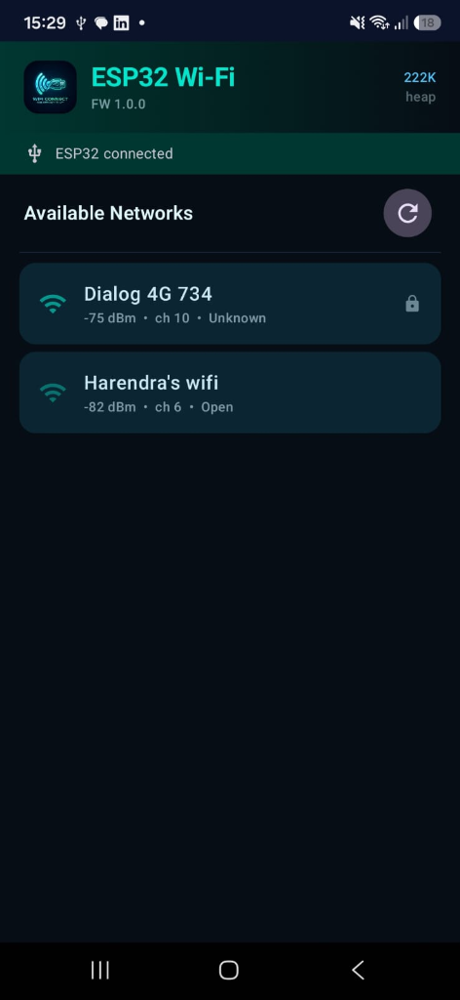

# ESP32 External Wi-Fi Adapter for Android (USB OTG)

<p align="center">
  
</p>

<p align="center">
  <b>A complete plug-and-play solution providing external Wi-Fi capability and system-wide internet to Android smartphones with broken or malfunctioning internal Wi-Fi hardware over a simple USB Type-C cable.</b>
</p>

<p align="center">
  <a href="releases/esp32-wifi-adapter-v1.0.1.apk"></a>
  
  
  
</p>

---

## Overview

If your smartphone's internal Wi-Fi IC is damaged or broken, this project restores full internet connectivity using an affordable, readily available **ESP32 DevKit** connected directly to your phone via USB.

- **System-Wide Internet:** Routes internet to **all** Android applications (browser, YouTube, WhatsApp, system updates) without needing root access.
- **Dedicated Android App:** Built with Jetpack Compose featuring real-time Wi-Fi scanning, signal strength metrics, heap monitoring, and one-tap network connection.
- **Zero-Copy lwIP NAT:** Custom ESP32 firmware running SLIP (RFC 1055) and lwIP Network Address Port Translation (NAPT) at 921,600 baud.
- **No Extra Power Needed:** The ESP32 is powered directly from your phone's USB Type-C port via USB OTG.

---

## How to Use This Software (Step-by-Step)

### Prerequisites & Hardware Required
1. **ESP32-WROOM-32 DevKit** (NodeMCU-32S, ESP32 DevKit v1, or similar with Micro-USB or Type-C).
2. **USB Type-C to Type-C cable** (or USB Type-C OTG adapter + USB-A to Micro-USB cable).
3. **Android Smartphone** running Android 8.0 or newer (tested on Samsung Galaxy A57 / One UI).
4. PC with **Arduino IDE** or **arduino-cli** (only needed once to flash firmware).

---

### Step 1: Flash the ESP32 Firmware

1. Connect your ESP32 to your PC via USB.
2. Open the Arduino sketch:
   [`esp32-firmware/esp32_wifi_adapter/esp32_wifi_adapter.ino`](esp32-firmware/esp32_wifi_adapter/esp32_wifi_adapter.ino)
3. In **Tools → Board**, select **ESP32 Dev Module** (under ESP32 Arduino core).
4. Select your ESP32's **COM Port** (e.g. `COM8`).
5. Click **Upload** (or run `arduino-cli compile -b esp32:esp32:esp32 esp32-firmware/esp32_wifi_adapter -u -p <COM_PORT>`).
6. Once the upload reaches 100%, disconnect the ESP32 from your PC.

---

### Step 2: Install the Android Application

1. Download the pre-built APK directly from this repository:
   👉 **[Download esp32-wifi-adapter-v1.0.1.apk](releases/esp32-wifi-adapter-v1.0.1.apk)**
2. Copy the APK to your Android phone (or download it directly from GitHub using your phone's mobile browser).
3. Tap the file to install it. If prompted, allow "Install from Unknown Sources".
   *(If you previously installed an older version, uninstall it first to ensure clean launcher icon caching).*

---

### Step 3: Connect Hardware via USB OTG

1. Plug one end of your Type-C cable into the **ESP32 DevKit**.
2. Plug the other end into your **Android phone's USB Type-C port**.
3. The ESP32 power LED will light up.

---

### Step 4: Open the App and Grant Permissions

1. Open the **ESP32 Wi-Fi** app from your home screen or app drawer.
2. A system prompt will appear:
   > *"Allow ESP32 Wi-Fi to access the USB device?"*
3. Check **Always allow** and tap **OK**.
4. The top status banner will turn green and display: `ESP32 connected` along with free heap memory and firmware version.

---

### Step 5: Scan & Connect to Wi-Fi

1. The app automatically scans for nearby 2.4 GHz Wi-Fi networks (or tap the **↻ Refresh** button to rescan).
2. Tap the Wi-Fi network you wish to connect to (e.g., *Harendra's wifi*).
3. If the network is password-protected, enter the Wi-Fi password.
4. Tap **Connect**.
5. The ESP32 will associate with the access point and obtain an IP address via DHCP.

---

### Step 6: Grant VPN Permission & Access the Internet

1. When connecting for the first time, Android will show a standard system VPN prompt:
   > *"ESP32 Wi-Fi wants to set up a VPN connection that allows it to monitor network traffic."*
2. Tap **OK / Accept**.
3. A key icon 🗝️ will appear in your Android status bar.
4. The connection status card will display:
   - **Status:** `Online`
   - **IP Address:** Assigned local IP from your Wi-Fi router
   - **Internet Ready:** Active
5. You can now minimize the app. Open Chrome, YouTube, Instagram, WhatsApp, or any other app — all your internet traffic is now streaming seamlessly through the external ESP32 Wi-Fi adapter!

---

## Architecture & Data Flow

```
[Android Apps & OS]
       │
       │ Raw IPv4 packets (0.0.0.0/0 default route)
       ▼
 [VpnService TUN 10.0.0.2]
       │
       │ SLIP frame encoding (RFC 1055: 0xC0 ... 0xC0)
       ▼
 [USB Serial Driver (CDC-ACM / CP2102 / CH340)]
       │
       │ 921,600 baud high-speed UART over USB OTG
       ▼
 [ESP32 Serial Task (Core 1)]
       │
       │ SLIP stream decode → pbuf packet injection
       ▼
 [lwIP IP Stack + NAPT (Core 0)]
       │
       │ NAT translation & forwarding (10.0.0.0/30 ↔ 192.168.x.x)
       ▼
 [ESP32 802.11 b/g/n Wi-Fi STA]
       │
       │ Wireless link (2.4 GHz)
       ▼
 [Wi-Fi Access Point / Router → Internet]
```

---

## Repository Structure

```
.
├── android-app/                       ← Native Android Application
│   ├── app/
│   │   ├── src/main/
│   │   │   ├── java/com/esp32wifiadapter/
│   │   │   │   ├── MainActivity.kt    ← Lifecycle & VPN launcher
│   │   │   │   ├── protocol/          ← SLIP encoder/decoder & JSON schemas
│   │   │   │   ├── usb/               ← USB Host serial driver
│   │   │   │   ├── vpn/               ← VpnService TUN forwarding bridge
│   │   │   │   ├── viewmodel/         ← MainViewModel state machine
│   │   │   │   └── ui/                ← Jetpack Compose UI & cyberpunk theme
│   │   │   └── res/                   ← Adaptive icons, mipmaps, strings
│   │   └── build.gradle
│   └── gradle/
├── esp32-firmware/                    ← ESP32 Firmware
│   └── esp32_wifi_adapter/
│       ├── esp32_wifi_adapter.ino     ← Main Arduino sketch (SLIP + NAPT)
│       └── settings.h                 ← Network configuration & constants
├── releases/                          ← Compiled ready-to-install binaries
│   └── esp32-wifi-adapter-v1.0.1.apk  ← Downloadable Android APK
├── docs/                              ← Detailed Documentation
│   ├── images/                        ← App screenshots and logos
│   ├── BUILD_AND_FLASH_GUIDE.md       ← Comprehensive flashing manual
│   └── FEASIBILITY_REPORT.md          ← Hardware & OS feasibility analysis
├── protocol/
│   └── PROTOCOL.md                    ← SLIP packet framing & JSON protocol
└── tests/
    └── TEST_MATRIX.md                 ← Validation checklist & test matrix
```

---

## Key Technical Specifications

| Parameter | Specification | Note |
|---|---|---|
| **USB Interface** | USB Serial (CP2102 / CH340 / CH9102) | Handled via Android USB Host API |
| **Baud Rate** | 921,600 bps | Maximizes throughput over UART |
| **Framing** | SLIP (RFC 1055) + Byte Type Prefix | `0x00` Data, `0x01` Cmd, `0x02` Resp |
| **Wi-Fi Standard** | 802.11 b/g/n (2.4 GHz) | ESP32-WROOM-32 hardware limitation |
| **IP Routing** | lwIP IPv4 NAPT | `ip_napt_enable((u32_t)WiFi.localIP(), 1)` |
| **Tunnel MTU** | 1500 bytes | Full standard Ethernet MTU |
| **Root Required** | **No** | Uses standard Android `VpnService` API |
| **Permissions** | `BIND_VPN_SERVICE`, `usb.host` | Zero internet permission required |

---

## Troubleshooting

- **ESP32 Not Detected:**
  - Verify your cable supports data transfer (some cheap cables are charging-only).
  - Ensure OTG is enabled in your phone's settings (on Samsung it is on by default).
- **Wi-Fi Network Not Appearing in Scan:**
  - The ESP32-WROOM-32 operates on **2.4 GHz only**. Ensure your router's 2.4 GHz SSID is enabled (5 GHz-only networks will not be visible).
- **Connection Takes a Few Seconds:**
  - Initial DHCP and WPA2 4-way handshake takes ~2–4 seconds. The app includes a 25-second watchdog to allow stable negotiation.

---

## License

This project is licensed under the MIT License — see the repository for details.
